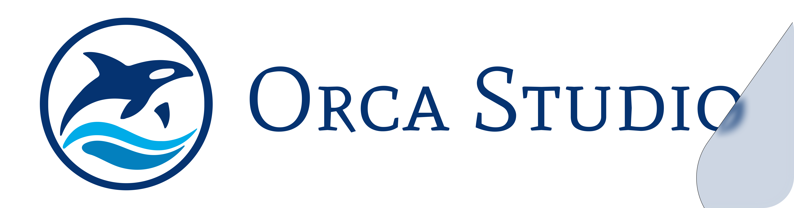

<p align="center">
  
</p>

<p align="center">
  <strong>A code-first studio for mathematical and technical explainer videos and Reels.</strong>
</p>

<p align="center">
  
  
  
  
  
</p>

---

Orca Studio turns an idea into a finished, narrated video. Every video is a
project with its own script, storyboard, animation code, and assets, and one
command builds the narration, times the animation to it, mixes the sound, and
renders the final MP4.

## Features

- **Two rendering stacks.** Vertical Reels and Shorts are built with
  [HyperFrames](https://www.npmjs.com/package/hyperframes), Three.js, and GSAP.
  Math-heavy scenes use [Manim Community Edition](https://www.manim.community/).
- **Local narration.** Voices come from [Kokoro](https://github.com/hexgrad/kokoro),
  which runs on your machine, so your script never leaves it. Edge TTS, Azure,
  OpenAI, ElevenLabs, and gTTS are available when you opt in.
- **Narration drives the timing.** WhisperX word timestamps (Reels) and
  `manim-voiceover` (Manim) keep every visual beat in sync with the voice. Switch
  voices and the whole video re-times itself.
- **Incremental builds.** `orca render` detects the project type and rebuilds only
  what is out of date: narration, timeline, sound mix, or picture.
- **Mastered sound.** Effects come from a shipped bank, and the mix is mastered
  to -14 LUFS before it is muxed with the picture.
- **A shared brand kit.** Colors, fonts, paper textures, and characters live in
  [`shared/brand/`](shared/brand/README.md), so every video looks like part of
  one series.
- **Hardware-aware setup.** `orca setup` detects your GPU and installs CUDA or CPU
  builds to match.

## Quick start

### Prerequisites

- [uv](https://docs.astral.sh/uv/)
- Git
- [FFmpeg](https://ffmpeg.org/) on `PATH`
- [Node.js](https://nodejs.org/) 22 or newer

### Install

```powershell
git clone https://github.com/Bharadwajreddy1406/Orca-Studio.git
cd Orca-Studio
npm install
.\orca setup        # macOS or Linux: ./orca setup
```

`orca setup` checks your GPU, asks which voice engine and tools you want,
installs them, and adds an `orca` launcher to `~/.local/bin`. Your choices are
saved in `orca.local.json`, which is not committed. Run `orca doctor` at any
time to check the GPU, tools, and disk space without changing anything.

### Render your first video

```powershell
orca list                    # see the projects and their type
orca render 003 --draft      # fast 30 fps preview of the Bubble Sort Reel
orca render 003              # full 1080p 60 fps render
```

The finished video is written to
`media/exports/003_bubble_sort/1080p60/003_bubble_sort_<voice>_merged.mp4`,
next to a silent `_video.mp4` and a `_cover.png`.

## Usage

| Command | What it does |
| --- | --- |
| `orca setup` | Checks this machine and installs what it needs |
| `orca doctor` | Shows the GPU, tools, and disk, changing nothing |
| `orca list` | Lists projects and their type |
| `orca voices` | Lists the voice shortlist, with sample files |
| `orca create "Name"` | Creates the next numbered project from `videos/_template` |
| `orca render 003` | Builds and renders a project |
| `orca render 003 --draft` | Faster 30 fps preview (HyperFrames) |
| `orca render 003 --voice bf_emma` | Switches the voice and renders |
| `orca render 003 --voice bf_emma,bm_george` | Renders one video per voice (HyperFrames) |
| `orca render 003 --force` | Rebuilds every step (HyperFrames) |
| `orca render 003 --dry-run` | Shows the steps without running them |

Projects can be referenced by number (`003`) or by full folder name
(`003_bubble_sort`). `orca` only runs inside this repository.

### Trying different voices

Listen to the samples in [`shared/voices/samples/`](shared/voices/samples/),
then render with the one you like:

```powershell
orca render 003 --voice bf_emma --draft
```

On HyperFrames projects the narration, timing, and mix are rebuilt for the new
voice, and the choice is saved to the project's `voiceover.json`. Each voice gets
its own output file, so variations never overwrite each other. Video length
follows the voice: a faster voice gives a shorter video, and a voice too slow for
the project's maximum length stops with an error instead of overrunning.

On Manim projects, `--voice` applies to that one render only.

### Manim renders

Manim projects also accept the presets of the lower-level `render` utility:

```powershell
orca render 001 --480p15     # default
orca render 001 --720p30
orca render 001 --1080p60
orca render 001 --2160p60
orca render 001 --no-merge   # skip the final merged MP4
```

Each render writes a silent video, a WAV narration track, subtitles when
available, and a merged MP4 to `media/exports/<project>/<preset>/`. Manim's own
output in `media/videos/` is kept as well.

### Voice providers

Each project chooses its speech service in `voiceover.json`:

```json
{
  "service": "kokoro",
  "voice": "bf_emma",
  "options": {}
}
```

Supported services are `kokoro` (local, the default), `edge-tts`, `gtts`,
`azure`, `elevenlabs`, and `openai`. Every service except Kokoro sends the
narration text to an external provider. Install the matching extra before using
one, for example `uv add "manim-voiceover[openai]"`, and keep API keys in
environment variables or `.env`, never in project files.

## How a video is made

Every video follows the same pipeline:

1. **`script.md`**: the narration, written for the ear, one spoken line per
   visual beat.
2. **`storyboard.md`**: what the viewer sees during each line.
3. **Implementation**: `scene.py` for Manim, or an HyperFrames composition for a
   Reel.
4. **Draft render**: check layout, pacing, and sync.
5. **Final render**: 1080p 60 fps, mixed, mastered, and muxed.

Reels follow a house style of 30 to 40 seconds: a hook, the problem, the idea,
how it works, and when it does not apply. The full rules are in
[`AGENTS.md`](AGENTS.md).

## Project structure

```text
Orca-Studio/
├── orca, orca.cmd        # the orca launcher
├── scripts/              # orca, create, render, and setup logic
├── shared/
│   ├── brand/            # channel brand kit: tokens, fonts, paper, characters
│   ├── reel/             # reusable Reel stage, cast, motion, and end card
│   ├── voices/           # Kokoro voice shortlist and samples
│   └── ...               # Manim helpers, narration and mix pipelines
├── docs/
│   ├── SOP.md            # exact working commands and known traps
│   └── manim_voiceover.md
├── videos/
│   ├── _template/        # copied by `orca create`
│   ├── 001_derivative_intuition/      # Manim
│   ├── 003_bubble_sort/               # HyperFrames reference Reel
│   └── ...
└── media/                # renders and exports (gitignored)
```

A Manim project holds `scene.py`, `script.md`, `storyboard.md`,
`voiceover.json`, and `assets/`. A HyperFrames project replaces `scene.py` with
`index.html`, its `build_*.py` steps, and a `source/` folder.

## Videos

| # | Title | Stack |
| --- | --- | --- |
| 001 | Why the Derivative Is Instantaneous Slope | Manim |
| 002 | What Survives a Collision? | Manim |
| 003 | Bubble Sort, One Tiny Rule | HyperFrames |
| 005 | Sequential Chaining | HyperFrames |
| 006 | Parallel Chaining | HyperFrames |
| 007 | Feedback Chaining | HyperFrames |
| 008 | Hierarchical Chaining | HyperFrames |
| 009 | Iterative Refinement | HyperFrames |
| 010 | Parallel Synthesis | HyperFrames |
| 011 | Routing | HyperFrames |

## Documentation

- [`docs/SOP.md`](docs/SOP.md): the step-by-step procedure for building a Reel,
  with every command and the known traps.
- [`docs/manim_voiceover.md`](docs/manim_voiceover.md): narration, timing, and
  bookmarks in Manim scenes.
- [`shared/brand/README.md`](shared/brand/README.md): the palette, typography,
  and visual rules.
- [`AGENTS.md`](AGENTS.md): the project's standing rules, including the Reel
  script house style.

## Platform support

Orca Studio is developed and tested on Windows. The macOS and Linux paths in
`orca setup` are written but untested.
