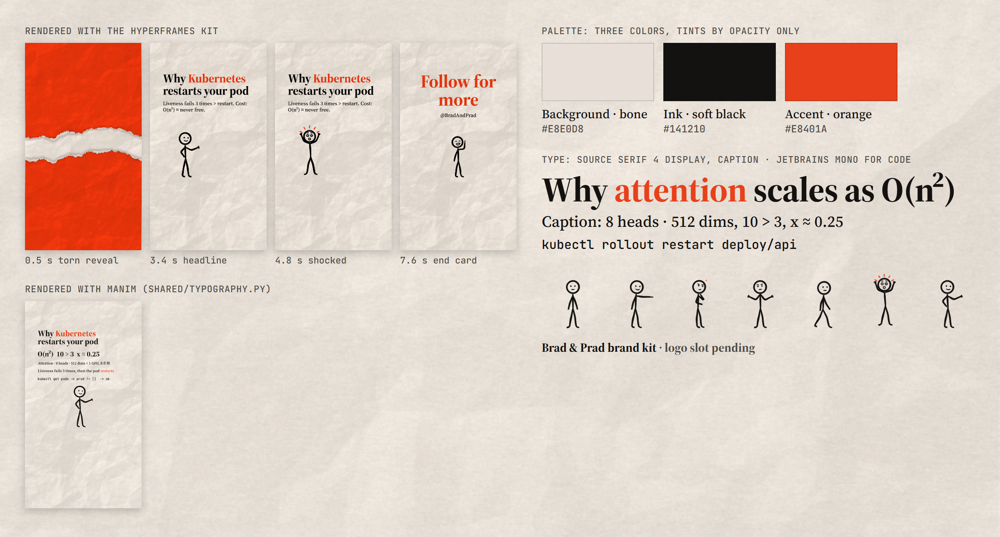

# Brad & Prad brand kit

Every Reel or Short on this channel uses this kit. Don't redefine any of it inside a video.
`tokens.json` is the only place brand values are written by hand. `brand.css` is generated
from it, and `shared/colors.py` and `shared/typography.py` read it when they are imported.



## Palette: three colors, nothing else

| Role | Hex | Use |
| --- | --- | --- |
| background (bone) | `#E8E0D8` | Paper and flat surfaces. About 75% of the frame. |
| ink (soft black) | `#141210` | Text, stick figures, diagrams. About 20%. |
| accent (orange) | `#E8401A` | One idea per frame: a key word, the torn reveal, the end card. About 5%. |

Contrast is 14.3:1 for ink on bone, 3.1:1 for accent on bone, and 4.6:1 for accent on ink.
Accent text is for large text only: Display at 64 px or more. Never set captions in accent.
For tints, use one of the three colors at lower opacity (`--brand-ink-soft`, `--brand-ink-faint`,
`--brand-shadow`, or Manim `set_opacity`). Don't mix a fourth color.

The values were measured from the channel's own frames and then cleaned up:
bone measured `#E8DDDD`, final `#E8E0D8` (slightly warmer); ink measured `#000702`, final
`#141210` (the requested soft black); headline orange measured `#F0421C`, which gave only
2.9:1 on bone, so it was darkened to `#E8401A`.

## Type

- **Source Serif 4 Display** (opsz 60, weight 700): headlines, 64 px or more. Warm,
  editorial serif display type.
- **Source Serif 4 Caption** (opsz 20, weight 500): captions and labels, 34 to 60 px.
- **JetBrains Mono Code** (weight 500, ligatures removed): code, commands, and YAML only.

All three are static cuts of the OFL originals, made by `tools/make_fonts.py`. Licenses are
in `fonts/*/OFL.txt`. They cover `² ≈ · < > → × √ Σ π ≤ ≥ θ λ`. For `∈`, or for real math,
use MathTex in Manim.

## Paper

`paper/paper_01_crumpled.webp` is the default. `paper_02_folded` is for variety, and
`paper_03_quiet` goes behind dense text or diagrams. All three are original procedural
images (`tools/generate_paper.py`) whose average color is exactly the background. Don't
tint or blur them. The only motion allowed is `BrandKit.paperJump`: hard stop-motion cuts
between the three sheets, about every 0.5 s and on key moments, never a fade or a slide. The deepest creases lower accent contrast to about 2.8:1, so
put accent words over a calm area, or use `paper_03_quiet`.

## Torn reveal

`torn/torn_top.webp` and `torn/torn_bottom.webp` are one orange sheet torn along a single
line (`tools/generate_torn.py`). Every video opens with `BrandKit.tornReveal` (about 1 s),
just as the channel's existing videos do.

## Stick figures

`stickman/stickman.js` draws an original hand-drawn figure in ink, with accent used only
for the shock and ponder marks.

- Poses: standing, pointing, pointing_up, thinking, shrugging, walk_contact, walk_passing,
  shocked, presenting, cheering, and `walk()` for a continuous walk cycle.
- Expressions: neutral, happy, delighted, shocked, thinking, confused, sad, determined.

Every frame is a pure function of time. There is no `Math.random`, and the wobble and
blinks are seeded. Drive the figure with `figure.attach(timeline, duration)`. For Manim,
use the static SVGs in `stickman/poses/` with `SVGMobject` (regenerate them with
`node tools/export_stickman.js`). Use one or two figures per frame. Feet stay at or above
y = 1250.

## Layout and series conventions

- The canvas is 1080 x 1920. Keep readable content inside `.bp-safe`: 270 px from the top,
  670 px from the bottom, and 120 px from each side (the same as `shared/instagram_reel.py`).
- Each video runs: torn orange reveal, then a hook headline with one accent word, then the
  explanation on paper, then the end card.
- End card: "Follow for more" in accent Display, the handle `@BradAndPrad` in Caption, the
  logo slot (see `logo/README.md`, still waiting on the file), and a cheering or
  pointing-up figure. Hold it for at least 2 s.

## Forbidden

Extra colors, gradients, neon or glow, stock cutouts and photos of people, emojis or
clip-art used as design elements, off-brand fonts (including the old condensed display
font), drop shadows on text, and a redrawn or traced logo.

## HyperFrames

```powershell
node shared/brand/hyperframes/install.js <project_dir> --starter
```

This copies the kit into `<project>/brand/`, because HyperFrames serves only the project
folder, and writes `index.html` from `hyperframes/starter.html`. That starter has the paper,
torn reveal, headline, accent word, animated figure, and end card. Everything loads from
local files, including GSAP (`vendor/gsap.min.js`, 3.15.0 under GSAP's standard no-charge
license), so no CDN is involved. Rerun the install after a kit change, and never edit the copy.

## Manim

```python
from shared.colors import ACCENT, BACKGROUND, INK, paper_background
from shared.instagram_reel import use_reel_canvas
from shared.typography import caption, code, headline

use_reel_canvas()
# inside construct():
self.add(paper_background(1))
title = headline("Why Kubernetes\nrestarts your pod", font_size=46, accent="Kubernetes")
```

`brand_text` registers the fonts, raises `BrandFontError` instead of falling back silently,
lays text out 6x larger and scales it down so kerning stays even, and colors the accent
substring with ligatures switched off. The Pango family strings that resolve are exactly
`"Source Serif 4 Display"`, `"Source Serif 4 Caption"`, and `"JetBrains Mono Code"`, each
with the default weight.

## Regenerating

```powershell
uv run python shared/brand/tools/build_tokens.py
uv run --no-project --with numpy --with scipy --with pillow python shared/brand/tools/generate_paper.py
uv run --no-project --with numpy --with scipy --with pillow python shared/brand/tools/generate_torn.py
uv run --no-project --with fonttools python shared/brand/tools/make_fonts.py <folder with the OFL variable fonts>
node shared/brand/tools/export_stickman.js
```

`build_tokens.py` writes `brand.css` after a token change and fails if any contrast pair
falls below 3:1.
